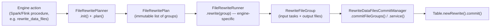

# Apache Iceberg — macOS Dev Setup, Testing, and the `actions` Package

*Generated 2026-10-10 for a local checkout at `/Users/ankursaran/dev/iceberg` (main @ 140f4654b).*

This doc has four parts:

1. **macOS build environment** — step by step, tailored to what's actually on this machine.
2. **Running unit tests locally** — whole repo, just `iceberg-core`, or a single test.
3. **How `org.apache.iceberg.actions` works** — the Planner → Plan → Runner → CommitManager pipeline, with a line-by-line walk through `RewriteDataFilesCommitManager.java`.
4. **Tying it to your real problem** — Flink CDC upsert at huge scale, V3 deletion vectors, and why you end up with a mountain of tiny delete files — plus which knobs in this exact package fix it.
5. **The concrete Flink maintenance pipeline** — how to actually wire up `ConvertEqualityDeletes` + `RewriteDataFiles` as a scheduled Flink job, with the exact builder API and scheduling knobs, and proof that it's the same `RewriteDataFilesCommitManager` from Part 3 underneath.

---

## Part 1 — macOS build environment

### 1.0 What's already on this Mac

Checked directly on this machine:

| Thing | Found |
|---|---|
| OS | macOS (arm64, Apple Silicon) |
| Homebrew | ✅ installed (`/opt/homebrew/bin/brew`) |
| Java on `PATH` | Homebrew OpenJDK **21.0.7** (`openjdk@21`), set in `~/.bash_profile` — ✅ supported |
| Other JDKs installed | Homebrew OpenJDK 24.0.2 (unversioned `openjdk`, too new), Temurin 21 |
| Gradle | not needed globally — the repo ships `./gradlew` |

**⚠️ The one blocker you *will* hit:** `build.gradle` hard-fails unless the JVM running Gradle is **exactly JDK 17 or 21**:

```groovy
// build.gradle
if (JavaVersion.current() == JavaVersion.VERSION_17 || JavaVersion.current() == JavaVersion.VERSION_21) {
  ...
} else {
  throw new GradleException("This build must be run with JDK 17 or 21 but was executed with JDK " + JavaVersion.current())
}
```

Homebrew's unversioned `openjdk` formula is 24, which this rejects outright. JDK 24 can stay installed, but Gradle must see 21. That's now done: `JAVA_HOME` points at Homebrew's versioned `openjdk@21` (see 1.3).

### 1.1 Install Xcode Command Line Tools (if not already)

```bash
xcode-select --install
```

Git, `clang`, etc. come from here; Homebrew depends on it. Skip if `git --version` already works (it does on this machine).

### 1.2 Install a build JDK (17 or 21)

This machine uses Homebrew's versioned formula (already installed):

```bash
brew install openjdk@21
```

Temurin 21 is also installed and registered with `/usr/libexec/java_home`. Either works.

```bash
/usr/libexec/java_home -V   # lists OpenJDK 24 (Homebrew) and Temurin 21
```

### 1.3 Point `JAVA_HOME` at the build JDK

This shell is **bash**, so the config lives in `~/.bash_profile`. Its old lines pointing at the unversioned `/opt/homebrew/opt/openjdk` (JDK 24) are commented out and replaced with:

```bash
export JAVA_HOME="/opt/homebrew/opt/openjdk@21/libexec/openjdk.jdk/Contents/Home"
export PATH="$JAVA_HOME/bin:$PATH"
```

Never use `/opt/homebrew/opt/openjdk/...`. That path always points to Homebrew's newest JDK, which is currently 24. A backup of the old profile is at `~/.bash_profile.bak-jdk21`.

Alternative using Temurin: `export JAVA_HOME="$(/usr/libexec/java_home -v 21)"`.

Reload, confirm, and kill any Gradle daemons started under JDK 24:

```bash
source ~/.bash_profile
java --version     # must print 21.x, NOT 24.x
./gradlew --stop
```

> If you want to flip between 17/21/24 often, consider [jenv](https://www.jenv.be/) (`brew install jenv`) instead of hardcoding one `JAVA_HOME` — but a plain export is fine for this repo since you'll mostly build with one version at a time.

### 1.4 Docker Desktop (needed for integration tests only)

A chunk of the test suite (Hive metastore, S3Mock/testcontainers-based catalog/IO tests, etc.) spins up containers via Testcontainers. Plain `./gradlew test` on `core` does **not** need Docker, but `integrationTest` tasks and several `*-hive-metastore` / `*-aws` tests do.

```bash
brew install --cask docker
open -a Docker   # start Docker Desktop once, let it finish initializing
```

The repo's own README calls out a macOS-specific Testcontainers gotcha — the Docker socket isn't where the library expects it by default on Docker Desktop for Mac:

```bash
sudo ln -s $HOME/.docker/run/docker.sock /var/run/docker.sock
```

You only need this if/when a test fails with a Testcontainers "could not find a valid Docker environment" error.

### 1.5 Clone and do a first build

```bash
git clone https://github.com/apache/iceberg.git
cd iceberg
./gradlew --version        # sanity check: pulls Gradle 8.14.5 via the wrapper, no local Gradle install needed
./gradlew build -x test -x integrationTest   # compile everything first, fast, no tests
```

First run will take a while (downloads the Gradle distribution + every dependency for every engine module — Spark 3.5/4.0/4.1/4.2, Flink 1.20/2.2/2.3, Hive, etc.). `gradle.properties` already caps JVM heap at `-Xmx1536m` and enables the build cache + parallel + configure-on-demand, so repeat builds are much faster.

**To build faster while iterating on core only**, skip pulling in the engine integration modules (same trick CI uses for the fast `check` job):

```bash
./gradlew build -x test -x integrationTest -DsparkVersions= -DflinkVersions= -DkafkaVersions=
```

### 1.6 IDE setup (IntelliJ IDEA — the one the Iceberg team itself uses)

1. `File → Open` the repo root (`build.gradle` at top level) and let IntelliJ import as a Gradle project.
2. Set **Project SDK** to the JDK 21 from 1.2 (`File → Project Structure → SDKs`).
3. Iceberg uses the **Immutables** annotation processor heavily (you saw this in `BaseRewriteDataFiles.java` — `@Value.Immutable` generates `ImmutableRewriteDataFiles.*` classes). Make sure **Settings → Build Tools → Gradle → Build and run using: IntelliJ IDEA** is *not* forced if you hit "annotation processing not run" errors — simplest fix is to just let Gradle do the build/test runs (delegate to Gradle) rather than IntelliJ's own compiler, since annotation processing is wired through the Gradle build.
4. Install the **google-java-format** / **Spotless** plugin awareness isn't required, but run `./gradlew spotlessApply` before committing (see Part 2).

### 1.7 Common first-build errors on macOS and fixes

| Error | Cause | Fix |
|---|---|---|
| `This build must be run with JDK 17 or 21 but was executed with JDK 24` | `JAVA_HOME`/active `java` is the Homebrew OpenJDK 24 | Redo 1.3, then `./gradlew --stop` |
| `Could not find a valid Docker environment` (Testcontainers) | Docker Desktop not running, or socket path | Start Docker Desktop; run the `ln -s` from 1.4 |
| Gradle daemon OOM / build hangs with huge heap use | Too many parallel workers for a laptop | Lower parallelism: `./gradlew build --max-workers=4` |
| Annotation-processor generated classes (`ImmutableRewriteDataFiles...`) not found in IntelliJ | IDE compiling instead of Gradle | Build/run via Gradle delegate (see 1.6.3) |

---

## Part 2 — Running unit tests locally

All commands run from the repo root, with `JAVA_HOME` set as in Part 1.

### 2.1 Run everything (slow — don't do this by default)

```bash
./gradlew test
```

### 2.2 Run just `iceberg-core`'s tests

**⚠️ Gotcha verified on this machine:** `settings.gradle:24` does `include 'core'`, which you'd expect to give a task path of `:core:test`. It doesn't. `settings.gradle:50` immediately renames it — `project(':core').name = 'iceberg-core'` — and because that rename happens in `settings.gradle` (before the project tree is finalized), it changes the **effective task path itself**, not just the published artifact/jar name. Running `./gradlew :core:test` fails with:

```
Cannot locate tasks that match ':core:test' as project 'core' not found in root project 'iceberg'.
```

Confirmed by running `./gradlew projects`, which lists the module as `Project ':iceberg-core'`. So you must address it by its *renamed* path:

```bash
./gradlew :iceberg-core:test
```

(Same renaming applies to every module in `settings.gradle` — e.g. `:api` → `:iceberg-api:test`, `:data` → `:iceberg-data:test`, etc. When in doubt, run `./gradlew projects` to get the authoritative path list.)

### 2.3 Run only the `actions` package's tests

```bash
./gradlew :iceberg-core:test --tests "org.apache.iceberg.actions.*"
```

Verified working end-to-end on this machine (JDK 21, `BUILD SUCCESSFUL`, 17 tasks executed). This covers every test under `core/src/test/java/org/apache/iceberg/actions/`:
`TestBinPackRewriteFilePlanner`, `TestBinPackRewritePositionDeletePlanner`, `TestCommitService`, `TestFileURI`, `TestRemoveDanglingDeleteFilesAction`, `TestSizeBasedFileRewritePlanner`.

(Note: there's no standalone `TestRewriteDataFilesCommitManager` — its behavior is exercised through `TestCommitService`, which tests the shared `BaseCommitService`/`CommitService` async-commit logic that `RewriteDataFilesCommitManager` wraps, and indirectly through the Spark/Flink `RewriteDataFilesAction` integration tests in their respective modules.)

### 2.4 Run a single test class

```bash
./gradlew :iceberg-core:test --tests "org.apache.iceberg.actions.TestCommitService"
```

### 2.5 Run a single test method

```bash
./gradlew :iceberg-core:test --tests "org.apache.iceberg.actions.TestCommitService.testCommittedResultsCorrectly"
```

### 2.6 Re-run with full output on failure

Gradle only prints a test's stdout/stderr on failure by default; to see everything:

```bash
./gradlew :iceberg-core:test --tests "org.apache.iceberg.actions.*" -i
```

### 2.7 Where results land

```
core/build/reports/tests/test/index.html   # human-readable HTML report
core/build/test-results/test/*.xml         # JUnit XML
```

Open the HTML report in a browser — it's the fastest way to see what failed and why.

### 2.8 Before you commit: code style

Iceberg enforces style via Spotless/Palantir Baseline in CI (`spotlessCheck` is part of `./gradlew check`):

```bash
./gradlew spotlessApply          # auto-fixes formatting for default engine versions
```

---

## Part 3 — How `org.apache.iceberg.actions` works, and `RewriteDataFilesCommitManager.java` in detail

### 3.1 The four-stage pipeline

Every compaction-style action (compact data files, compact position deletes, etc.) in this package follows the same documented pipeline (from `FileRewritePlanner`'s javadoc, `core/src/main/java/org/apache/iceberg/actions/FileRewritePlanner.java:26-49`):



| Class | Role |
|---|---|
| `FileRewritePlanner` | Scans the table, decides **which** files need rewriting and how to group them. Produces a `FileRewritePlan`. |
| `SizeBasedFileRewritePlanner` | Abstract base: size-threshold selection (`MIN_FILE_SIZE_BYTES`, `MAX_FILE_SIZE_BYTES`, `TARGET_FILE_SIZE_BYTES`) + bin-packing into groups (`MAX_FILE_GROUP_SIZE_BYTES`). |
| `BinPackRewriteFilePlanner` | Concrete planner for **data files**. Adds delete-count/delete-ratio-driven selection (`DELETE_FILE_THRESHOLD`, `DELETE_RATIO_THRESHOLD`) and job ordering. |
| `BinPackRewritePositionDeletePlanner` | Same idea, but for **position-delete files / DVs**, producing `RewritePositionDeletesGroup`s. |
| `FileRewritePlan` | Immutable output of a planner — a list of groups. |
| `FileRewriteRunner` | Engine-specific (lives in Spark/Flink modules, not core) — actually reads input files and writes new ones for a group. |
| `RewriteGroupBase` | Abstract "unit of work": the input scan tasks for a group, plus sizing hints (`maxOutputFileSize`, `inputSplitSize`, `expectedOutputFiles`) the runner should use. |
| `RewriteFileGroup` | The data-file flavor of a group: tracks which `DataFile`s go in, which come out, and which delete vectors become dangling. |
| `RewriteDataFilesCommitManager` | **(your file)** Turns one or more finished `RewriteFileGroup`s into an atomic `RewriteFiles` table commit, with cleanup on failure. |
| `BaseCommitService` / `CommitService` | Async batching layer: lets a runner `offer()` completed groups as they finish (in parallel), and commits them in batches without blocking the rewrite threads — this is what makes "partial progress" commits possible. |
| `RewritePositionDeletesCommitManager` | The delete-file-only sibling of `RewriteDataFilesCommitManager`, for `rewrite_position_delete_files`. |

### 3.2 `RewriteDataFilesCommitManager.java` — line by line

File: `core/src/main/java/org/apache/iceberg/actions/RewriteDataFilesCommitManager.java`

**State (fields, lines 39–43):**
- `table` — the table being compacted.
- `startingSnapshotId` — the snapshot the plan was computed against; used for optimistic-concurrency validation.
- `useStartingSequenceNumber` — if true, the rewritten data files are committed with the **original** sequence number instead of a new one (keeps row-level delete matching semantics correct — a compacted file must still look "as old" as the data it replaced for delete files written against the old files to keep applying correctly).
- `snapshotProperties` — custom key/values stamped onto the commit (e.g. who/what triggered it).
- `branch` — commit target branch, or `null` for the table's main branch.

**`commitFileGroups(Set<RewriteFileGroup> fileGroups)` (lines 86–113)** — the actual atomic commit:
1. Flattens every group's `rewrittenFiles()` (old data files being removed), `addedFiles()` (new compacted data files), and `danglingDVs()` (deletion vectors that pointed at an old data file and are now orphaned) into three sets.
2. Opens `table.newRewrite().validateFromSnapshot(startingSnapshotId)` — this is the optimistic-concurrency guard: if the table moved on from `startingSnapshotId` in a conflicting way (e.g. someone deleted one of these files concurrently), the commit will fail/retry rather than silently corrupt state.
3. If `useStartingSequenceNumber`, pins the operation's data sequence number to the starting snapshot's sequence number.
4. `deleteFile()` on every rewritten data file **and** every dangling DV, `addFile()` on every new data file — all in the same `RewriteFiles` operation, so from a reader's perspective the swap is atomic (never sees old files gone but new ones missing, or a DV pointing at a file that no longer exists).
5. Stamps `snapshotProperties`, optionally targets `branch`, commits.

**`abortFileGroup(RewriteFileGroup fileGroup)` (lines 121–130)** — if a group's new files were written but the commit path is being abandoned (e.g. another error elsewhere in a partial-progress batch), physically delete the orphan files it already wrote via `table.io().deleteFile(...)`. Best-effort: failures here are logged, never thrown (`suppressFailureWhenFinished()`), because you're already in an error path and don't want cleanup itself to mask the original error.

**`commitOrClean(Set<RewriteFileGroup>)` (lines 132–150)** — wraps `commitFileGroups` with failure handling:
- `CommitStateUnknownException` (e.g. network partition after the write landed server-side but before the client got the ack) is **re-thrown without cleanup** — you genuinely don't know if the commit succeeded, so deleting the new files could delete files that are now live in the table.
- Any other `CleanableFailure` (a failure type known to be safe — the commit definitely didn't apply) triggers `abortFileGroup` on every group in the batch before re-throwing.

**`CommitService` inner class (lines 160–179)** wraps `BaseCommitService<RewriteFileGroup>` (same file's package, `BaseCommitService.java`) so engines can stream groups in as they finish rewriting rather than waiting for every group in the whole table to be done before committing anything.

### 3.3 `BaseCommitService` — the partial-progress engine

File: `core/src/main/java/org/apache/iceberg/actions/BaseCommitService.java`

This is a small producer/consumer system:
- `offer(group)` (line 145) — a rewrite worker thread calls this the instant a group's new files are written. It's pushed onto `completedRewrites`, then `commitReadyCommitGroups()` is checked immediately.
- `commitReadyCommitGroups()` (line 211) only forms a batch when `canCreateCommitGroup()` (line 243) is true: either the queue has reached `rewritesPerCommit` groups, or writing is finished (`running == false`) and there's a remainder to flush.
- A **single-threaded** `committerService` executor (line 89) does the actual `commitOrClean(batch)` calls, so commits against the same table are naturally serialized even though many rewrite workers are producing groups in parallel.
- `close()` (line 162) stops accepting new groups, waits up to `TIMEOUT_IN_MS_DEFAULT` = **120 minutes** for in-flight commits to drain, and if it times out, aborts whatever's left uncommitted rather than losing track of orphan files.

This is exactly the mechanism behind Spark/Flink's "partial progress" option for `rewrite_data_files` — instead of one gigantic commit at the end (which on a huge table risks a very large, very slow, very conflict-prone single `RewriteFiles` commit), the table gets several smaller commits as compaction progresses, each one covering `rewritesPerCommit` groups.

---

## Part 4 — Your actual problem: Flink CDC upsert at scale, V3 deletion vectors, and delete-file explosion

Everything below is grounded in the Flink and core sources in this checkout, with file:line citations.

### 4.1 What actually happens on the Flink write path during an upsert

For upsert mode, `BaseDeltaTaskWriter.write()` (`flink/v2.3/.../sink/BaseDeltaTaskWriter.java:81-111`) calls `deleteKey(...)` for every updated/deleted key. Inside `BaseEqualityDeltaWriter.internalPosDelete` (`core/src/main/java/org/apache/iceberg/io/BaseTaskWriter.java:273-307`), there's a branch:

- **If the row being deleted was *inserted earlier in the same checkpoint*** (tracked in a local `insertedRowMap`), it writes a **position delete / DV** — cheap, intra-checkpoint, no cross-checkpoint lookup needed.
- **Otherwise** (the far more common real-CDC case — you're updating a row that was committed in some *earlier* checkpoint), it falls through to `eqDeleteWriter.write(key)` — an **equality delete**.

So in genuine CDC upsert traffic, **equality delete files, not deletion vectors, are what your streaming job is actually producing** on the hot path.

Granularity matters here: each task has **one shared DV writer** (`PartitioningDVWriter`, `BaseTaskWriter.java:116`), but **one separate rolling equality-delete writer per partition** (`RollingEqDeleteWriter`, instantiated per `RowDataDeltaWriter` in `PartitionedDeltaWriter.java:79`). So the file count per checkpoint scales as roughly:

```
equality-delete files per checkpoint  ≈  (# parallel sink tasks) × (# distinct partitions touched by that task)
```

At your scale — 100B upserts, presumably many partitions, many parallel tasks, many checkpoints over the job's lifetime — that multiplies out fast. **This is your bottleneck**: not literally "a delete file per row," but a new small equality-delete file per (task × partition) on every single checkpoint, compounding over however many checkpoints the job runs. Every read later has to consult `DeleteFileIndex` and merge-apply the full backlog of these against the matching data files — more files to open, more metadata to plan, slower scans.

### 4.2 Why this isn't "fixed" just by DVs being in V3

It's tempting to assume "V3 has deletion vectors, so this is solved." Two things push back on that, both confirmed in code:

1. **DVs *can* be wholesale-merged with history** — `BaseDVFileWriter.close()` (`core/src/main/java/org/apache/iceberg/deletes/BaseDVFileWriter.java:101-151`) loads any `previousPositions` for the data file, merges in the new ones, writes a single new Puffin blob, and marks the old DV for removal. Spark's position-delta write path wires a real previous-delete loader for exactly this (`spark/.../SparkPositionDeltaWrite.java:538-553`). **But the live Flink streaming sink hardcodes this loader to `p -> null`** (`BaseTaskWriter.java:116`) — so even the DVs it does write intra-checkpoint are never merged against history on the hot path. DVs alone don't save you here; and the dominant output (equality deletes) isn't DVs at all.
2. **`DeleteFileIndex` enforces "at most one live DV per data file"** (`core/src/main/java/org/apache/iceberg/DeleteFileIndex.java:568-576`, throws `ValidationException` otherwise). That invariant is a promise about the *final, compacted* state, not something the streaming writer maintains for you as it goes.

### 4.3 The actual fix is a two-layer system — and you need both layers

**Layer 1 — `ConvertEqualityDeletes` maintenance pipeline** (Flink-side, format v3 only): `flink/v2.3/.../maintenance/api/ConvertEqualityDeletes.java` (checks format version ≥ 3 at lines 280-286) is a scheduled background operator, purpose-built for exactly this problem. It periodically reads up the accumulated equality-delete files and, via `EqualityConvertDVWriter.java:183-222`, resolves each one against its referenced data file and rewrites it as a single merged deletion vector — satisfying the `DeleteFileIndex` one-DV-per-file invariant. It's scheduled by either:
   - `schedule.commit-count` (default **1** — i.e. after every single table commit) or
   - `schedule.interval-second`
   (`ConvertEqualityDeletesConfig.java:38-54`).

   **For a 100B-upsert job, this is the knob to tune first.** If it isn't enabled, or its schedule is too loose relative to your checkpoint interval, equality deletes accumulate unbounded between runs — which matches exactly the symptom you're describing.

**Layer 2 — the `org.apache.iceberg.actions` compaction machinery from Part 3** (`BinPackRewriteFilePlanner` + `RewriteDataFilesCommitManager`): this is the heavier path that also resizes/merges the *data* files, not just the deletes. It's still necessary periodically, for two reasons specific to your scenario:
   - `BinPackRewriteFilePlanner`'s `DELETE_FILE_THRESHOLD` / `DELETE_RATIO_THRESHOLD` (`BinPackRewriteFilePlanner.java:70-87`) force a data file into a rewrite group once it's accumulated too many deletes or too high a deleted-row ratio — *even if the file is otherwise a perfectly fine size* — which is exactly the shape of damage billions of upserts do to old data files.
   - When a data file is rewritten, **every** delete type pointing at it (equality deletes that resolved to it, position deletes, and any DV) is retired — the DV-specific case is `RewriteFileGroup.danglingDVs()` (`RewriteFileGroup.java:65-69`), collected and deleted atomically alongside the old data file in `RewriteDataFilesCommitManager.commitFileGroups()` (the method you read in Part 3.2). Layer 1 keeps delete-file *count* bounded between compactions; Layer 2 is what actually shrinks file count and reclaims space from rows that have been logically deleted for a while.

   If you want to shrink delete-file count **without** touching data files (e.g. data files are already well-sized, you just have delete-file sprawl), `RewritePositionDeletesCommitManager` + `BinPackRewritePositionDeletePlanner` is the lighter-weight option — but note it operates on position-deletes/DVs, not equality deletes directly, so equality-delete cleanup still routes through Layer 1 or a full data rewrite.

### 4.4 Concrete recommendations for your 100B-upsert table

1. **Enable/tighten `ConvertEqualityDeletes` scheduling** to match your checkpoint cadence — don't leave it at defaults if checkpoints are frequent; a looser `schedule.interval-second` than your checkpoint interval is how equality-delete count runs away.
2. **Still run periodic full compaction** (`rewrite_data_files`, i.e. Part 3's `BinPackRewriteFilePlanner` + `RewriteDataFilesCommitManager`) with `delete-file-threshold` / `delete-ratio-threshold` tuned aggressively (low) for a heavy-upsert table — the defaults (`Integer.MAX_VALUE` / `0.3`, `BinPackRewriteFilePlanner.java:72,87`) assume a much less delete-heavy workload than yours.
3. **Use partial-progress commits** for that compaction given the table's scale — `RewriteDataFiles.PARTIAL_PROGRESS_ENABLED` / `PARTIAL_PROGRESS_MAX_COMMITS` (`api/src/main/java/org/apache/iceberg/actions/RewriteDataFiles.java:43-53`), which is the engine-facing switch for exactly the `BaseCommitService`/`CommitService` batching mechanism from Part 3.3 — one giant commit over a 100B-row table is itself a bottleneck and a conflict risk; many small commits as groups finish is not.
4. **Reconsider partition cardinality / checkpoint interval** if you have room to: since equality-delete file count scales with `(tasks touched) × (partitions touched)` per checkpoint (section 4.1), reducing either lever directly reduces the delete-file multiplication factor at the source, independent of any downstream compaction.

---

## Part 5 — The concrete Flink maintenance pipeline (`TableMaintenance`)

Part 4 named `ConvertEqualityDeletes` and compaction as the two fixes. This part shows **exactly how to wire them up** as a single scheduled Flink job, using the real builder API in this checkout (`flink/v2.3/flink/src/main/java/org/apache/iceberg/flink/maintenance/`), and proves the connection back to Part 3's `RewriteDataFilesCommitManager`.

### 5.1 Proof: the scheduled compaction task *is* `RewriteDataFilesCommitManager`

This is directly confirmed in code, not inferred:

```java
// flink/.../maintenance/operator/DataFileRewriteCommitter.java:169
private class FlinkRewriteDataFilesCommitManager extends RewriteDataFilesCommitManager {
  ...
}
```

`DataFileRewriteCommitter` (the commit stage of Flink's scheduled `RewriteDataFiles` maintenance task) literally subclasses the exact `core/src/main/java/org/apache/iceberg/actions/RewriteDataFilesCommitManager.java` you read in Part 3 — same `commitFileGroups`/`commitOrClean`/`abortFileGroup` logic, same `CommitService` async batching. The planning stage, `DataFileRewritePlanner`, is a thin Flink operator wrapper around `BinPackRewriteFilePlanner` (also Part 3). So everything you learned in Part 3 about dangling-DV cleanup, `validateFromSnapshot`, and partial-progress batching is literally what runs when you schedule this Flink task — it's not a separate reimplementation.

### 5.2 `ConvertEqualityDeletes` — what it needs and how it's scheduled

File: `flink/v2.3/flink/src/main/java/org/apache/iceberg/flink/maintenance/api/ConvertEqualityDeletes.java`

Required builder inputs:
- **`.stagingBranch(name)`** — required, no default (`Preconditions.checkNotNull`, line 148). This is the branch the conversion *reads* equality-delete and data files from.
- **`.targetBranch(name)`** — defaults to `main` (line 92). Where the merged DVs + data files get committed.
- **`.equalityFieldColumns(List<String>)`** — required, must exactly match the equality columns your Flink `IcebergSink` upsert writer is configured with (javadoc, line 116-118: "Mirrors `IcebergSink.Builder#equalityFieldColumns`").

If your sink writes **directly to `main`**, set `stagingBranch` and `targetBranch` to the same value — the code explicitly supports this ("in-place conversion"), with a boolean check (`stagingBranch.equals(targetBranch)`) that changes internal read/commit behavior accordingly (`ConvertEqualityDeletes.java:177,194`). You don't need a separate staging-branch write pattern unless you want one.

**Hard requirement:** table format version ≥ 3 — enforced at `ConvertEqualityDeletes.java:280-286`, throws `IllegalArgumentException` otherwise ("`ConvertEqualityDeletes` requires table format version >= 3 (DVs)").

**Scheduling** — two ways to configure it:
1. `.config(new ConvertEqualityDeletesConfig(table, writeOptions, readableConfig))` — reads `flink-maintenance.convert-equality-deletes.schedule.commit-count` (default **1** — i.e. after *every* commit) and `...schedule.interval-second` (no default) from table/write properties (`ConvertEqualityDeletesConfig.java:40-54`).
2. Or call the scheduling methods directly on the builder (it extends `MaintenanceTaskBuilder`, section 5.4) — e.g. `.scheduleOnEqDeleteFileCount(n)` or `.scheduleOnEqDeleteRecordCount(n)`, which trigger based on the actual accumulated equality-delete file/record counts rather than a fixed commit cadence. **For your 100B-upsert workload, this is the more precise knob** — commit-count=1 reacts to *every* commit regardless of how much delete volume that commit produced, whereas `scheduleOnEqDeleteFileCount`/`scheduleOnEqDeleteRecordCount` react to the actual thing you're trying to bound.

### 5.3 `RewriteDataFiles` (Flink maintenance) — scheduling and tuning knobs

File: `flink/v2.3/flink/src/main/java/org/apache/iceberg/flink/maintenance/api/RewriteDataFiles.java` + `RewriteDataFilesConfig.java`

Builder methods map straight onto Part 3's planner options:

| Builder method | Underlying core option | Default |
|---|---|---|
| `.targetFileSizeBytes(n)` | `SizeBasedFileRewritePlanner.TARGET_FILE_SIZE_BYTES` | table's `write.target-file-size-bytes` |
| `.minFileSizeBytes(n)` / `.maxFileSizeBytes(n)` | `MIN_FILE_SIZE_BYTES` / `MAX_FILE_SIZE_BYTES` | 75%/180% of target |
| `.deleteFileThreshold(n)` | `BinPackRewriteFilePlanner.DELETE_FILE_THRESHOLD` | `Integer.MAX_VALUE` (disabled) |
| `.maxFilesToRewrite(n)` | `BinPackRewriteFilePlanner.MAX_FILES_TO_REWRITE` | unset (rewrite all selected) |
| `.partialProgressEnabled(true)` / `.partialProgressMaxCommits(n)` | `RewriteDataFiles.PARTIAL_PROGRESS_ENABLED` / `_MAX_COMMITS` | `false` / `10` |

**No dedicated `.deleteRatioThreshold(double)` builder method exists** — but `.config(RewriteDataFilesConfig)` merges in *any* raw property under `flink-maintenance.rewrite.*` verbatim (`RewriteDataFilesConfig.java:173-175`, `properties()` strips the prefix), so setting `flink-maintenance.rewrite.delete-ratio-threshold=0.05` as a table/write property reaches `BinPackRewriteFilePlanner.DELETE_RATIO_THRESHOLD` even without a typed builder method for it.

Scheduling defaults (`RewriteDataFilesConfig.java:61-92`) — all four can be set independently, and per the trigger logic in 5.4, **any one being satisfied fires the task**:
- `schedule.commit-count` → default **10**
- `schedule.data-file-count` → default **1000**
- `schedule.data-file-size` → default **100 GB**
- `schedule.interval-second` → default **600** (10 min)

### 5.4 How scheduling actually decides to fire: OR, not AND

`TriggerEvaluator.check()` (`flink/.../maintenance/operator/TriggerEvaluator.java:38-45`) runs every configured predicate and fires on `predicates.stream().anyMatch(...)` — **any one** threshold being crossed (commit count, data-file count/size, eq-delete file/record count, pos-delete file/record count, or elapsed time) triggers that maintenance task's next run. So stacking several `scheduleOn*` calls on one builder gives you "whichever happens first" semantics, not "all must agree."

### 5.5 Wiring both tasks together with shared locking

`ConvertEqualityDeletes.java:71-72` states explicitly: *"Mutual exclusion with concurrent maintenance tasks (e.g. compaction) is enforced by the Flink maintenance framework lock."* That framework is `TableMaintenance` (`flink/.../maintenance/api/TableMaintenance.java`) — you register every maintenance task on one `TableMaintenance.Builder` and it serializes them for you via a shared `TriggerManager` + lock (`TableMaintenance.java:267-376`), so a `ConvertEqualityDeletes` run and a `RewriteDataFiles` run can never race on the same table.

Putting Parts 4 and 5 together, a maintenance job shaped for your 100B-upsert, CDC-heavy table:

```java
TableLoader tableLoader = TableLoader.fromCatalog(...);

TableMaintenance.forTable(env, tableLoader)
    .rateLimit(Duration.ofSeconds(30))
    .add(
        ConvertEqualityDeletes.builder()
            .stagingBranch("main")          // in-place: same as targetBranch default
            .equalityFieldColumns(List.of("id"))   // must match the sink's upsert key(s)
            // react to actual eq-delete volume, not just "after every commit":
            .scheduleOnEqDeleteFileCount(200)
            .scheduleOnEqDeleteRecordCount(5_000_000L))
    .add(
        RewriteDataFiles.builder()
            .deleteFileThreshold(5)          // force-rewrite a data file once 5+ deletes land on it
            // .deleteRatioThreshold via raw property, see 5.3 — e.g. 0.05 for a heavy-upsert table
            .partialProgressEnabled(true)    // don't let one giant commit become its own bottleneck
            .partialProgressMaxCommits(50)
            .scheduleOnDataFileCount(5_000)
            .scheduleOnInterval(Duration.ofMinutes(15)))
    .append();
```

This gives you: equality deletes get converted into merged DVs continuously based on actual delete volume (Layer 1, Part 4.3), while data files that have accumulated too many deletes still get fully compacted — with dangling DVs cleaned up atomically by the real `RewriteDataFilesCommitManager` — on a schedule that also won't let one compaction run try to commit the whole table at once (Layer 2).
